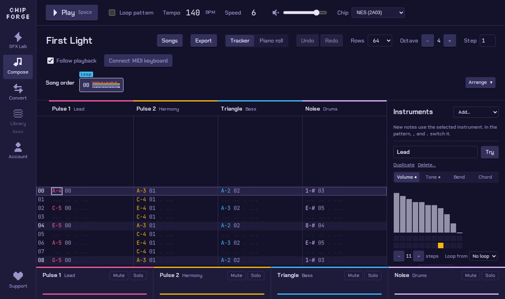
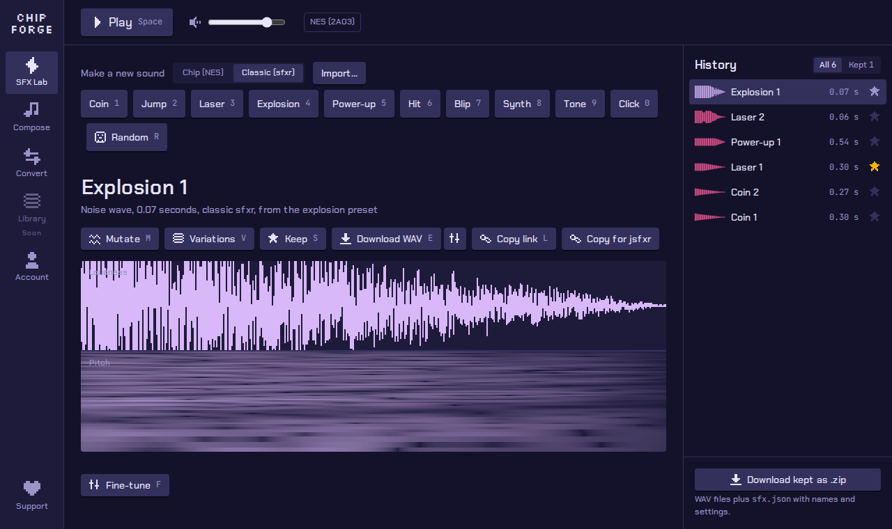
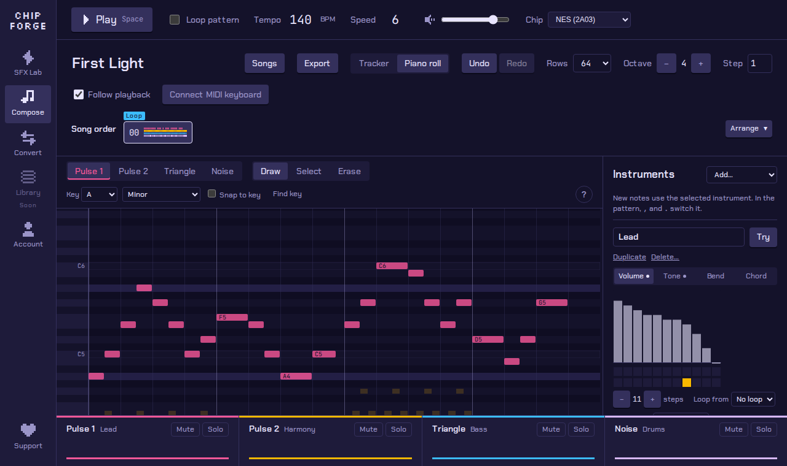
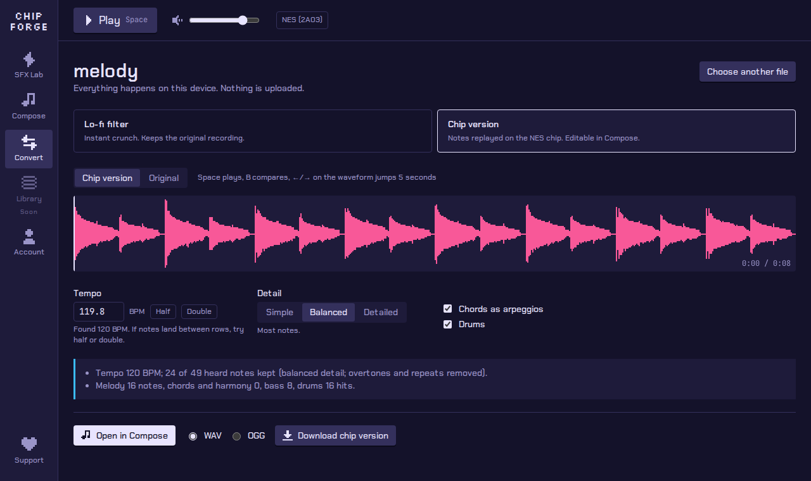

# ChipForge

Retro game audio, made in your browser. Make **8-bit sound effects**, write **chiptune
songs** on an emulated NES or Game Boy chip, or **turn any song into 8-bit**. Free, open
source, works offline, and nothing you make is ever uploaded.

[Open ChipForge](app/){: .btn .btn-primary }
[Download for Windows, macOS, Linux](https://github.com/spiritpaper/chipforge/releases/latest){: .btn }
[Getting started](docs/guide/getting-started.md){: .btn }

{: .shot }

## For game developers

- **Sound effects in seconds.** Press a key for a coin, jump, laser or explosion, mutate
  until it's right, download the lot as a zip. [Sound effects](docs/guide/sound-effects.md)
- **Music that loops.** Start from a template, export OGG or WAV with loop points engines
  read. [Exporting](docs/guide/export.md)
- **Music that reacts.** Godot and Unity plugins play songs live from tiny files: switch
  sections on the bar line, mute layers, change tempo. [Game engines](docs/guide/game-engines.md)
- **Yours to ship.** Everything you make is royalty-free, commercial use included, no
  credit required. [FAQ](docs/guide/faq.md)

## For video creators

Retro background tracks, intros and sound effects for game channels, reviews and
streams, all yours to use in monetized videos. [For video creators](docs/guide/video-creators.md)

## Three tools in one

| | |
|---|---|
| {: .shot } | **SFX Lab.** Two synths: a real NES chip, and classic sfxr that opens jsfxr, sfxr and rFXGen sounds exactly. Presets, mutate, eight variations at once, locks, plain-language fine-tuning, WAV, OGG and zip export, share links. |
| {: .shot } | **Compose.** A tracker and a piano roll on the same song, instruments you draw, templates, keys and scales that keep you in tune, one-click beats, MIDI keyboard input, songs opened from MIDI, MusicXML, ABC, FamiTracker and MOD, export with loop points, fit to length and stems, and four chip channels: Pulse 1, Pulse 2, Triangle, Noise. |
| {: .shot } | **Convert.** Drop in an MP3 or WAV. The Lo-fi filter crunches the recording instantly; Chip version listens for the notes, beat and drums and rebuilds the song on the chip, ready to edit. Split into parts first, and the vocals, bass, drums and other instruments each get their own channel. |

## Open source

ChipForge's code is on [GitHub](https://github.com/spiritpaper/chipforge): the chip
emulation, the engine plugins and the C library are MIT, the app and server AGPL-3.0
([Licensing](LICENSING.md)). Bugs, ideas and contributions are welcome:
[Contributing](CONTRIBUTING.md). Installers are built from this source by GitHub
Actions; see [Code signing](docs/CODE_SIGNING.md).
